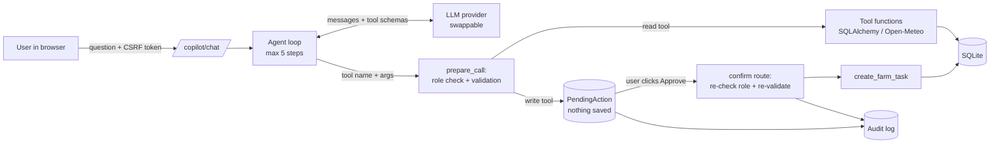

# SmartFarm AI: Architecture

## Assessment of the original project
- Flask blueprints + Flask-SQLAlchemy + SQLite + Jinja/Bootstrap 5 + Chart.js. Clean and small.
- Roles: `admin` (farm owner) and `worker`. Session login. Decorators `login_required` / `admin_required`.
- **Single-farm data model**: there is no farm/owner column. Admins see all records; workers see only tasks
  assigned to them. True multi-owner isolation would need a schema change (see Known limitations).
- Gaps closed in this upgrade: no CSRF protection, hardcoded fallback `SECRET_KEY`, debug server on `0.0.0.0`,
  destructive `seed.py` with no warning.

## What was added (nothing was removed)
```
services/
  ai/validation.py   pure input validation (no Flask/DB)
  ai/tools.py        tool registry: 8 tools, roles, validators, write-tool gate
  ai/actions.py      proposal -> confirm/reject -> execute, plus audit log
  ai/agent.py        orchestration loop (max steps), system prompt
  ai/llm.py          replaceable provider layer (OpenAI-compatible client)
  weather.py         Open-Meteo client (geocoding + 7-day forecast, 30 min cache)
  planner.py         rule-based weekly planner
  security.py        CSRF
models/ai.py         ai_audit_log, ai_chat_messages, ai_pending_actions (new tables only)
routes/copilot.py    /copilot, /copilot/chat, /copilot/quick/<tool>, confirm/reject, /planner, /api/weather
```

## Request flow


## Safety design
| Risk | Control |
|---|---|
| Model invents data | System prompt + tools return recorded data; fallback never fakes a reply |
| Model runs arbitrary SQL/code | No such tool exists; every tool rejects unexpected parameters |
| Model changes data silently | Write tools only create a `PendingAction`; saving needs a user click |
| Stale/forged approval | Confirm route checks ownership, status, role again and re-validates inputs |
| Worker reaches owner data | Role list per tool; tools not offered to workers; checked again at execution |
| Prompt injection via records | Prompt says tool output is data; writes still need approval |
| XSS from AI/DB text | Jinja autoescape; JS uses `textContent` only |
| CSRF | Session token required on every POST (form field or `X-CSRF-Token`) |
| API key leakage | Key only read from environment; error messages never include it |

## Database changes (non-destructive)
Three new tables are created by `db.create_all()`. Existing tables and rows are untouched.
Back up with `python scripts/backup_db.py` before upgrading anyway.
